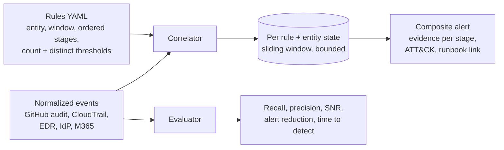

# Behavioral Correlation Engine


Single-event signatures ("a token was created", "an AWS role was assumed") are either too noisy to page on or too quiet to catch a real intrusion. This engine chains **low-severity behaviors into one high-confidence composite alert**: same entity, stages in order, inside a sliding time window, with count and distinct-value thresholds. Every rule is **measured** on labeled data, tuned against realistic false-positive bait, and ships with a runbook.

## Composite rules

| Rule | Entity | Chain (in order, inside the window) | Window | ATT&CK |
| --- | --- | --- | --- | --- |
| [token-to-cloud-theft](rules/token_clone_role_chain.yml) | identity | GitHub PAT created → ≥20 clones of ≥15 distinct repos → AWS AssumeRole from an IP new for that identity | 60 min | T1528, T1213.003, T1078.004 |
| [ransomware-precursor](rules/ransomware_precursor.yml) | host | Share enumeration (ShareFinder, SharpShares, net view) → archiver → rclone / b2.exe | 4 h | T1135, T1560.001, T1567.002 |
| [spray-to-mailbox-access](rules/spray_then_mailbox.yml) | source IP | ≥10 failed sign-ins across ≥10 accounts → a success → MailItemsAccessed | 60 min | T1110.003, T1078.004, T1114.002 |

The ransomware and spray chains come from my threat briefs on [CISA AA26-293A (SafePay) and AA26-281A](https://github.com/mk7git-hub/cti-threat-briefs).

## Results

Evaluated on 26,825 seeded, labeled events covering 14 days for a 300-person company: **9 injected attack chains, 11 near-miss benign chains** (repo migrations, travelling engineers, a shared office NAT) and background noise that breaks naive rules (CI bots cloning 60 repos nightly, a backup server that archives and rclone-syncs every night, internet sprays that fail all day).

| Rule | Single-event alerts | Composite alerts (tuned) | Recall | Precision | SNR (TP:FP) | Alert reduction | Median time to detect |
| --- | --- | --- | --- | --- | --- | --- | --- |
| token-to-cloud-theft | 14,372 | 3 | 3/3 | 1.00 | 3:0 | 99.98% | 35 min |
| ransomware-precursor | 149 | 3 | 3/3 | 1.00 | 3:0 | 97.99% | 90 min |
| spray-to-mailbox-access | 11,101 | 3 | 3/3 | 1.00 | 3:0 | 99.97% | 28 min |

Full output: [reports/evaluation.md](reports/evaluation.md). "Time to detect" runs from the first malicious event to the composite alert, so it includes the attacker's own pace between steps.

## Tuning log

| Rule | v1 draft | False positives in v1 | Root cause | Change |
| --- | --- | --- | --- | --- |
| token-to-cloud-theft | 5 clones of 5 repos, any AssumeRole | 8 (precision 0.27) | Repo migrations and travel | ≥20 clones of ≥15 distinct repos, role from a **new** IP |
| ransomware-precursor | 24 h window, `net share` counts as enumeration | 13 (precision 0.19) | Backup server: daily `net share`, nightly 7-Zip and rclone | 4 h window, drop `net share` |
| spray-to-mailbox-access | 3 failures, 3 accounts | 3 (precision 0.50) | Shared office NAT with password typos | ≥10 failures across ≥10 accounts |

All three tuned rules kept 3/3 recall: tuning removed noise without creating blind spots, and a CI test fails if a future change loses a detection or reintroduces false positives.

## How it works



- State is per (rule, entity); events older than the window drop off, so memory stays bounded at stream rates.
- Each alert carries the evidence events for every stage: the analyst sees the whole story, not one log line.
- Entity normalization matters: the token chain needs one identity across GitHub and AWS (SSO email), and the README states that assumption rather than hiding it.

## Run it

```bash
pip install -r requirements.txt
python -m bce.synth        # writes data/events.jsonl (seeded, labeled)
python -m bce.evaluate     # v1 vs tuned metrics -> reports/evaluation.md
pytest -q                  # 8 tests, including "tuned rules keep 3/3 recall with 0 FP"
```

## Production notes

- **Stream engine:** the same rule model maps onto Splunk `transaction`/`streamstats`, Sentinel `scan` / Fusion-style analytics, or a Kafka consumer. Python here keeps the logic readable and testable.
- **Enrichment:** `new_ip_for_actor` comes from a 30-day per-identity IP baseline; computing it is an upstream job.
- **Honest scope:** the data is synthetic and labeled so precision and recall are measurable; real tuning starts from these thresholds and iterates on production volume.
